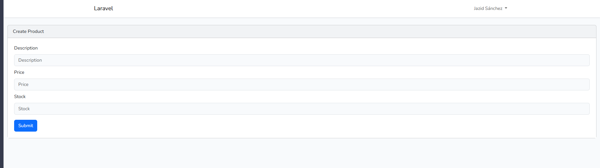
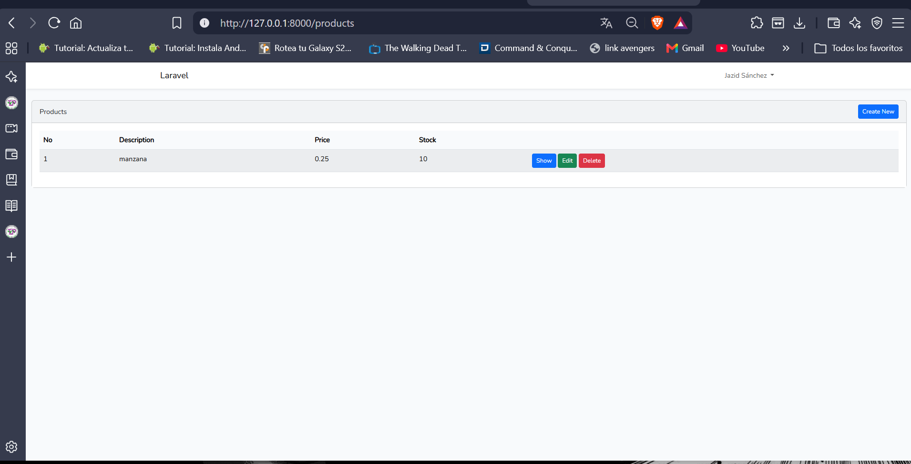
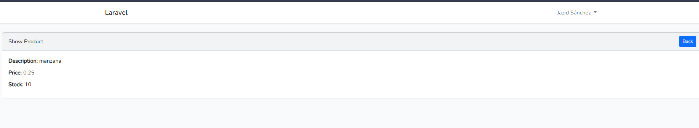
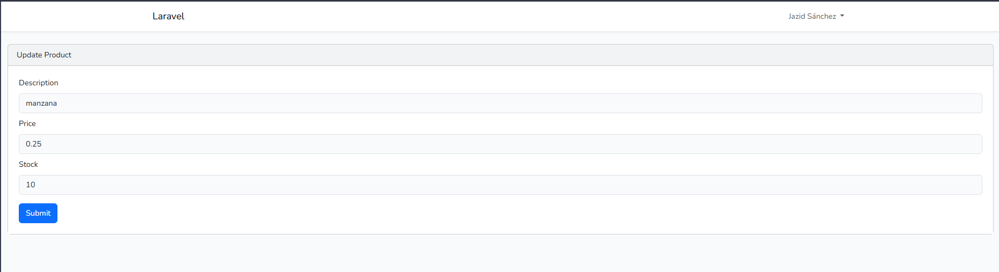
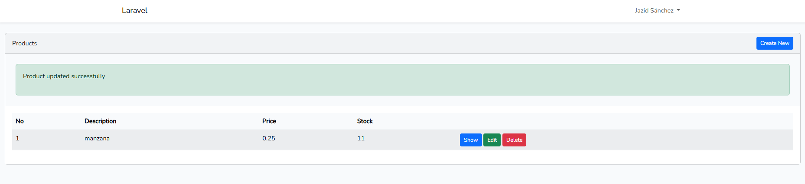
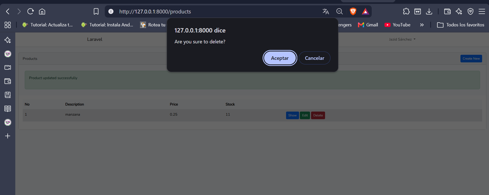
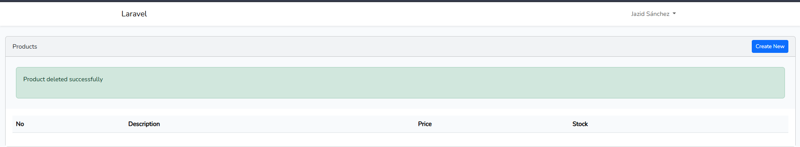

# CRUD Rápido con Laravel

**Herramientas de la Programación Aplicada I**

Este repositorio contiene la solución del **Laboratorio #2: Acercamiento a un CRUD rápido en Laravel**. Es una aplicación web para gestionar **productos** (descripción, precio y existencias) que permite **crear, leer, actualizar y eliminar** registros en una base de datos MySQL. El CRUD se generó con el paquete `ibex/crud-generator` y vistas en Blade con Bootstrap.

## 📑 Contenido

1. [Insertar registros](#1--insertar-registros-imágenes)
2. [Evidencia de acciones de Modificar](#2--evidencia-de-acciones-de-modificar-imágenes)
3. [Evidencia de acciones de Eliminar](#3--evidencia-de-acciones-de-eliminar-imágenes)
4. [Controles utilizados](#4--controles-utilizados)
5. [Detalles del laboratorio](#5--detalles-del-laboratorio)
6. [Procesos de instalación](#6--procesos-de-instalación)
7. [Tecnologías y versiones](#7--tecnologías-y-versiones)
8. [Detalles del autor, fecha y referencias](#8--detalles-del-autor-fecha-y-referencias)

> 📌 **Nota:** a diferencia de un ejercicio de consola, esta práctica **sí usa base de datos y formularios**. Los "registros" son las filas de la tabla `products` en MySQL. *Insertar* = guardar un producto con el formulario de creación, *Modificar* = editar sus datos con el formulario de edición, y *Eliminar* = borrar el producto con el botón **Delete**. Todo se prueba en la ruta `/products`.

---

## 1. 📥 Insertar registros (Imágenes)

### 1.1 Formulario de creación – `products/create`
El botón **Create New** del listado abre el formulario con los campos *Description*, *Price* y *Stock*. Al presionar **Submit**, los datos se validan con `ProductRequest` y se guardan en la tabla `products`.



### 1.2 Registro insertado – `products`
Después de guardar, el producto (`manzana`, precio `0.25`, stock `10`) aparece en el listado.



### 1.3 Consultar un registro – `products/{product}`
El botón **Show** muestra el detalle del producto.



---

## 2. ✏️ Evidencia de acciones de Modificar (Imágenes)

### 2.1 Formulario de edición – `products/{product}/edit`
El botón **Edit** abre el formulario *Update Product* con los datos actuales cargados (`manzana`, precio `0.25`, stock `10`). Aquí se cambia el valor que se desea modificar; en este caso, el **stock de 10 a 11**.



### 2.2 Registro modificado
Al presionar **Submit**, el controlador ejecuta `update()`, aparece el mensaje *Product updated successfully* y el listado muestra el stock actualizado a `11`.



---

## 3. 🗑️ Evidencia de acciones de Eliminar (Imágenes)

### 3.1 Antes de eliminar
Al presionar **Delete**, el navegador pide confirmación con el mensaje *Are you sure to delete?*. Se acepta para continuar.



### 3.2 Después de eliminar
Al aceptar, el controlador ejecuta `destroy()`, aparece el mensaje *Product deleted successfully* y el producto desaparece del listado y de la tabla `products`.



---

## 4. 🎛️ Controles utilizados

### Controles de la interfaz

| Control | Descripción | Dónde se usa |
|---|---|---|
| Campo de texto (`input`) | Ingreso de la descripción del producto | Formularios crear / editar |
| Campos numéricos (`input`) | Ingreso de precio y existencias | Formularios crear / editar |
| Botón **Create New** | Abre el formulario de creación | Listado |
| Botón **Submit** | Envía y guarda los datos | Formularios |
| Botón **Show** | Muestra el detalle del producto | Listado |
| Botón **Edit** | Abre el formulario de edición | Listado |
| Botón **Delete** | Elimina el producto (con confirmación del navegador) | Listado |
| Botón **Back** | Regresa al listado | Vista Show |
| Tabla | Lista los registros (No, Description, Price, Stock) | Listado |
| Barra de navegación | Navegación general (layout con Bootstrap) | Todas las vistas |

### Conceptos y herramientas de Laravel

| Concepto | Descripción | Dónde se usa |
|---|---|---|
| Migración (`Schema::create`) | Define la estructura de la tabla `products` | `database/migrations/..._create_products_table.php` |
| Modelo Eloquent | Representa la tabla y accede a los datos | `app/Models/Product.php` |
| `$fillable` | Protege contra asignación masiva | `app/Models/Product.php` |
| `Route::resource` | Crea las 7 rutas del CRUD | `routes/web.php` |
| Controlador | Lógica: `index`, `create`, `store`, `show`, `edit`, `update`, `destroy` | `app/Http/Controllers/ProductController.php` |
| `FormRequest` | Validación de los datos del formulario | `app/Http/Requests/ProductRequest.php` |
| Vistas Blade | Plantillas HTML (`index`, `create`, `edit`, `show`, `form`) | `resources/views/product/` |
| Layout Blade | Estructura común de todas las páginas | `resources/views/layouts/app.blade.php` |
| `Schema::defaultStringLength(191)` | Evita el error de longitud de llave | `app/Providers/AppServiceProvider.php` |
| Comandos Artisan | `make:model`, `migrate`, `make:crud`, `route:list`, `config:clear`, `serve` | Terminal |

---

## 5. 🧪 Detalles del laboratorio

| Campo | Detalle |
|---|---|
| Curso | Herramientas de la Programación Aplicada I |
| Laboratorio | #2 – Acercamiento a un CRUD rápido en Laravel |
| Docente | Ing. Irina Fong |
| Objetivo | Crear una aplicación que permita crear, leer, actualizar y eliminar productos usando migraciones, Eloquent y un generador de CRUD |
| Base de datos | `crud_rapido` (MySQL) |
| Tabla | `products` |

### Estructura de la tabla `products`

| Columna | Tipo | Descripción |
|---|---|---|
| `id` | Entero autoincremental | Llave primaria |
| `description` | `string` | Descripción del producto |
| `price` | `double(8,2)` | Precio (8 dígitos, 2 decimales) |
| `stock` | `integer` | Existencias |
| `created_at`, `updated_at` | `timestamp` | Fechas de creación y actualización |

### Rutas del CRUD (`Route::resource`)

| Método | URL | Acción | Nombre |
|---|---|---|---|
| GET | `/products` | `index` | `products.index` |
| GET | `/products/create` | `create` | `products.create` |
| POST | `/products` | `store` | `products.store` |
| GET | `/products/{product}` | `show` | `products.show` |
| GET | `/products/{product}/edit` | `edit` | `products.edit` |
| PUT/PATCH | `/products/{product}` | `update` | `products.update` |
| DELETE | `/products/{product}` | `destroy` | `products.destroy` |

### Estructura principal del proyecto

```text
crud_rapido/
├── app/
│   ├── Http/
│   │   ├── Controllers/ProductController.php
│   │   └── Requests/ProductRequest.php
│   ├── Models/Product.php
│   └── Providers/AppServiceProvider.php
├── database/migrations/
│   └── ..._create_products_table.php
├── resources/views/
│   ├── layouts/app.blade.php
│   └── product/           # index, create, edit, show, form
├── routes/web.php
├── imagenes/              # Capturas usadas en este README
└── README.md
```

---

## 6. ⚙️ Procesos de instalación

### Requisitos previos
* **WampServer** (Apache y MySQL en verde), **PHP**, **Composer**, **Node.js** con npm, **Git** y **Visual Studio Code**.

### Instalar y ejecutar el proyecto

1. **Clonar el repositorio** dentro de la carpeta `www` de WampServer:
   ```bash
   cd C:\wamp64\www
   git clone https://github.com/jazidsanchez-create/Lab_crud-rapido.git
   cd Lab_crud-rapido
   ```
2. **Instalar las dependencias:**
   ```bash
   composer install
   npm install
   ```
3. **Crear el archivo de entorno:**
   ```bash
   copy .env.example .env
   php artisan key:generate
   ```
4. **Crear la base de datos** `crud_rapido` en phpMyAdmin (`http://localhost/phpmyadmin`).
5. **Configurar el `.env`:**
   ```env
   DB_CONNECTION=mysql
   DB_HOST=127.0.0.1
   DB_PORT=3306
   DB_DATABASE=crud_rapido
   DB_USERNAME=root
   DB_PASSWORD=
   ```
6. **Ejecutar las migraciones:**
   ```bash
   php artisan config:clear
   php artisan migrate
   ```
7. **Compilar el frontend** (dejar esta terminal abierta):
   ```bash
   npm run dev
   ```
8. **Levantar el servidor** (en otra terminal):
   ```bash
   php artisan serve
   ```
9. **Abrir en el navegador:** http://127.0.0.1:8000/products

### Cómo se creó el proyecto (resumen)

```bash
laravel new crud_rapido
php artisan make:model Product -m
php artisan migrate
composer require ibex/crud-generator --dev
php artisan vendor:publish --tag=crud
php artisan make:crud products      # stack: Blade with Bootstrap css
```

Y se registró la ruta en `routes/web.php`:

```php
Route::resource('products', ProductController::class);
```

### Problemas comunes y soluciones

| Problema | Solución |
|---|---|
| `Specified key was too long; max key length is 1000 bytes` | Agregar `Schema::defaultStringLength(191);` en `AppServiceProvider::boot()`, poner `'engine' => 'InnoDB'` en `config/database.php` y ejecutar `php artisan migrate:fresh` |
| El cambio en el `.env` no se aplica | `php artisan config:clear` |
| Clase no encontrada | `composer dump-autoload` |
| Página sin estilos o error de *Vite manifest* | Ejecutar `npm install` y mantener `npm run dev` activo |

---

## 7. 🌐 Tecnologías y versiones


| Tecnología | Versión |
|---|---|
| Laravel | X.X *(verifica con `php artisan --version`)* |
| PHP | X.X *(verifica con `php -v`)* |
| MySQL | X.X *(incluido en WampServer; se ve en phpMyAdmin)* |
| WampServer | 3.x |
| Composer | X.X *(verifica con `composer -V`)* |
| Node.js / npm | X.X / X.X *(verifica con `node -v` y `npm -v`)* |
| laravel/ui (Bootstrap) | 4.6.3 |
| ibex/crud-generator | X.X *(ver en `composer.json`)* |
| Vite | Incluido con Laravel |
| Visual Studio Code | Última versión estable |
| Git / GitHub | Git 2.x |

---

## 8. 👨‍💻 Detalles del autor, fecha y referencias

**Autor:** Jazid Sánchez – 8-1038-1191
**Carrera:** Licenciatura en Ciberseguridad
**Institución:** Universidad Tecnológica de Panamá
**Facultad:** Facultad de Ingeniería de Sistemas Computacionales

📧 **Email:** jazid.sanchez@utp.ac.pa
🌐 **GitHub:** https://github.com/jazidsanchez-create

📅 **Fecha de creación:** 16 de octubre de 2026
📅 **Última actualización del README:** 16 de octubre de 2026

### 📚 Referencias

* Fong, I. (2026). *Guía del Laboratorio #2 de CRUD con Laravel* [Presentación]. Universidad Tecnológica de Panamá.
* Laravel. (2026). *Laravel Documentation*. https://laravel.com/docs
* Laravel. (2026). *Database: Migrations*. https://laravel.com/docs/migrations
* Laravel. (2026). *Eloquent: Getting Started – Mass Assignment*. https://laravel.com/docs/eloquent#mass-assignment
* Laravel. (2026). *Controllers – Resource Controllers*. https://laravel.com/docs/controllers#resource-controllers
* Laravel. (2026). *Laravel UI*. https://github.com/laravel/ui
* Awais, M. (2026). *Laravel CRUD Generator (ibex/crud-generator)*. https://github.com/awais-vteams/laravel-crud-generator
* Tutorial de apoyo del laboratorio. https://www.youtube.com/watch?v=j5baJsM_Adc&t=111s
